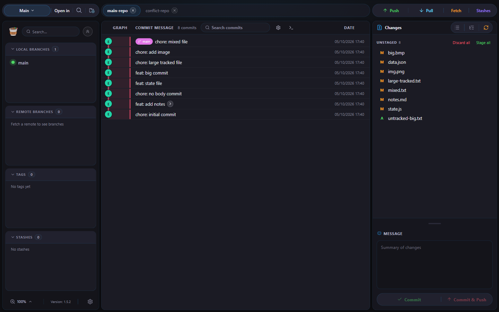
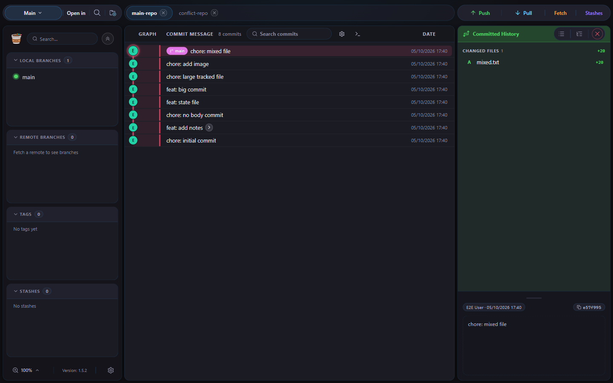
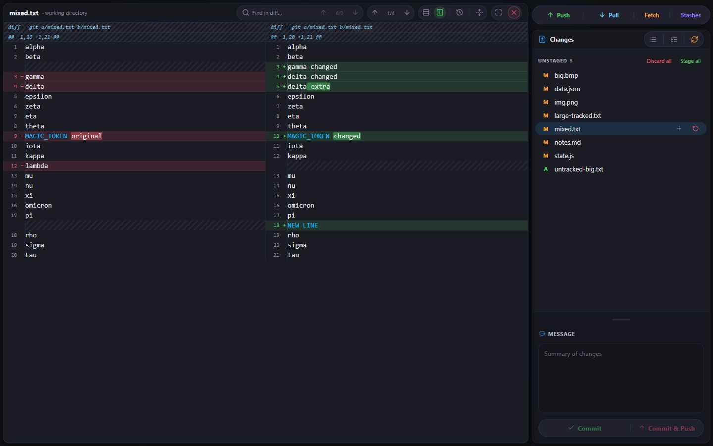
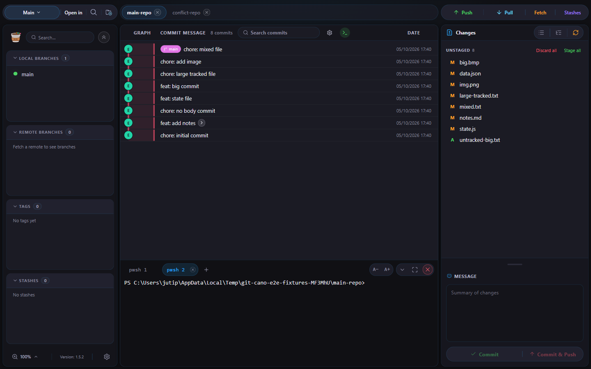
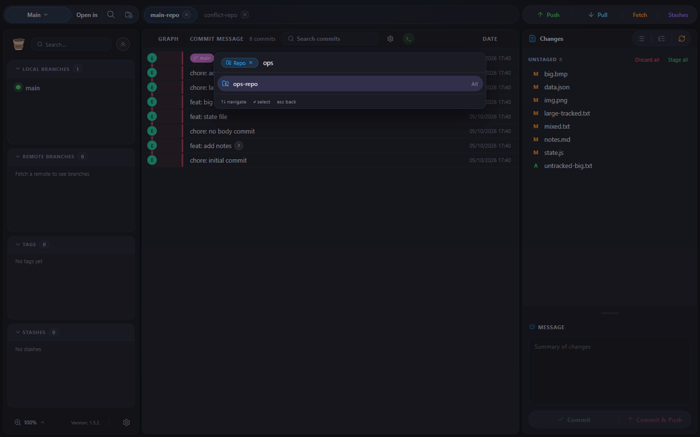

<div align="center">


# git-cano

**Everyday Git, without the clutter.**

A lightweight, open-source Git GUI for Windows and macOS — review history, stage changes, manage branches, and commit in one calm place.

[](https://github.com/Jutipong/git-cano/releases/latest)
[](LICENSE)
[](#install)
[](https://www.electronjs.org)
[](https://vuejs.org)
[](https://www.typescriptlang.org)
[](https://pnpm.io)

[Install](#install) · [Features](#features) · [Shortcuts](#shortcuts) · [Development](#development) · [Report an issue](https://github.com/Jutipong/git-cano/issues)

</div>



## Screenshots

| Commit history                                 | Side-by-side diff                          |
| ---------------------------------------------- | ------------------------------------------ |
|  |  |

| Terminal                                            | Command palette                                       |
| --------------------------------------------------- | ----------------------------------------------------- |
|  |    |

## Why git-cano

- **Fast by default** — local data renders first, remote tags load in the background, and the commit graph is virtualized.
- **Git stays out of the UI** — every operation runs in the main process through `simple-git`.
- **A terminal that respects Thai** — a real PTY with xterm Unicode 11 widths and UTF-8 forced on Windows.
- **AI when you want it** — optional commit messages via OpenCode Go or OpenRouter.

## Features

### Repositories & workspaces

- Open and clone repositories; keep several open as tabs.
- Workspaces group repos and remember their tabs and active repo.
- Find any repo across all workspaces from the command palette.
- Restore your session and recent repos on startup.

### History & diffs

- Interactive commit graph with branch/tag chips, author details, and search.
- Stage files or single hunks; commit and amend with a title-length counter.
- Unified or side-by-side diffs with word-level highlights, image diffs, and binary detection.
- Blame lens, per-file history, reflog viewer, and rendered Markdown/JSON previews.
- Solo a branch to focus its history; files that branch never touched fade in Changes.

### Branches, tags & remotes

- Create, checkout, delete, merge, rebase, and cherry-pick from the graph.
- Interactive rebase with reorder, reword, squash, fixup, edit, and drop.
- Tags, remotes, fetch/pull/push, and stashes.
- Per-line conflict resolver with manual editing.

### Terminal

- Built-in terminal panel with up to four shell tabs per repo.
- Shells survive repo and workspace switches; tabs can be renamed and reordered.
- Ctrl/Cmd+click a printed URL to open it in your default browser.
- Configurable shell and font size, independent of the interface font size.

### AI commit messages _(optional)_

- OpenCode Go or OpenRouter providers, with a model list scoped to your catalog.
- Generate from staged changes, or auto-commit and push.
- Fast `minimal` reasoning effort, with optional auto-format before generating.

### Interface

- Light, dark, and Win9x themes, with per-theme graph lane colors.
- Command palette for repos, actions, and settings.
- Customizable shortcuts per platform.
- Transient toasts with a countdown, plus a timed Undo for risky actions.

## Install

Download the latest build from **[GitHub Releases](https://github.com/Jutipong/git-cano/releases/latest)**.

**Windows**

Run `git-cano-<version>-setup.exe` and follow the installer. In-app updates are supported. The build is unsigned, so SmartScreen may warn — choose **More info → Run anyway**.

**macOS (Apple Silicon)**

The `.dmg` is unsigned and updated manually. Open it, drag **Git Cano** into Applications, then clear the quarantine flag once:

```bash
xattr -cr /Applications/Git\ Cano.app
```

Right-click **Git Cano → Open** the first time you launch it.

## Development

Requires [Node.js](https://nodejs.org), [pnpm](https://pnpm.io) 10+, and Git on `PATH`.

```bash
pnpm install
pnpm approve-builds electron esbuild   # first time only
pnpm dev
```

| Command          | Description                        |
| ---------------- | ---------------------------------- |
| `pnpm dev`       | Dev mode with hot reload           |
| `pnpm build`     | Production build                   |
| `pnpm typecheck` | Type checking (vue-tsc + tsc)      |
| `pnpm test:unit` | Unit tests                         |
| `pnpm test:e2e`  | Build and run Playwright tests     |
| `pnpm format`    | Format with oxfmt                  |
| `pnpm dist:win`  | Windows installer → `release/`     |
| `pnpm dist:mac`  | macOS `.dmg` → `release/`          |

```text
src/
├── main/       # Electron main process and all Git operations
├── preload/    # Secure window.api bridge
├── shared/     # Shared types and graph helpers
└── renderer/   # Vue 3 app: components, Pinia stores, styles
```

Git never runs in the renderer: every call flows `component → window.api → main process → simple-git`.

## Shortcuts

<details>
<summary><b>Show the cheat sheet</b></summary>

| Action             | macOS               | Windows                |
| ------------------ | ------------------- | ---------------------- |
| Fetch              | `Ctrl+Shift+↓`      | `Ctrl+Shift+↓`         |
| Pull / Push        | `Ctrl+↓` / `Ctrl+↑` | `Ctrl+↓` / `Ctrl+↑`    |
| Open / clone repo  | `Ctrl+O` / `Ctrl+N` | `Ctrl+O` / `Ctrl+N`    |
| New terminal tab   | `Ctrl+T`            | `Ctrl+T`               |
| Search commits     | `⌘F`                | `Ctrl+F`               |
| Command palette    | `Ctrl+P` / `Shift×2`| `Ctrl+P` / `Shift×2`   |
| Commit             | `⌘↵`                | `Ctrl+↵`               |
| Settings           | `Ctrl+,`            | `Ctrl+,`               |
| Zoom in / out      | `⌘=` / `⌘-`         | `Ctrl+=` / `Ctrl+-`    |
| Show shortcuts     | `?`                 | `?`                    |

Shortcuts for fetch, pull, push, open, clone, search, settings, and the palette can be rebound per platform in **Settings → Shortcuts**.

</details>

## Good to know

- Remote tag status needs an `origin` remote and a network connection; it loads in the background on purpose.
- Cherry-pick and branch merge refuse to run on a dirty worktree and ask you to commit or stash first.
- Push, pull, fetch, and clone ignore `GIT_CONFIG_*` and `GIT_SSH_COMMAND` exported by other tools and inject their own credentials.
- A branch and a tag may share a name; the sidebar keeps each ref unambiguous.

## License

[MIT](LICENSE) © git-cano contributors

Building with AI? Read [AGENTS.md](AGENTS.md) first.
