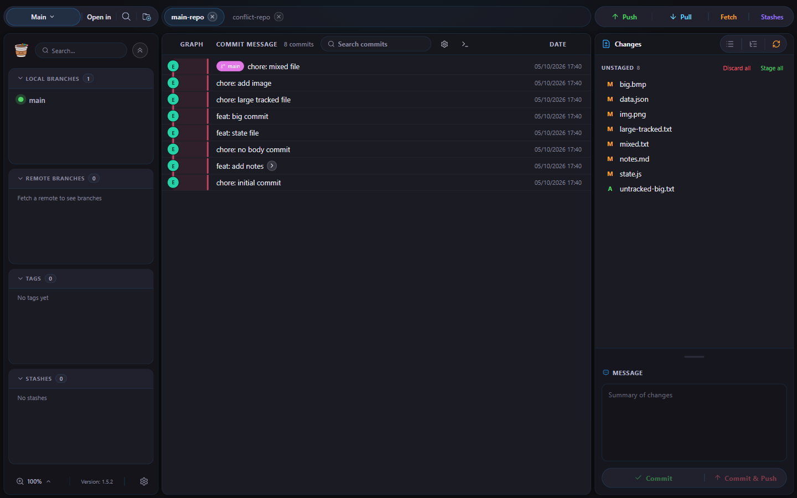
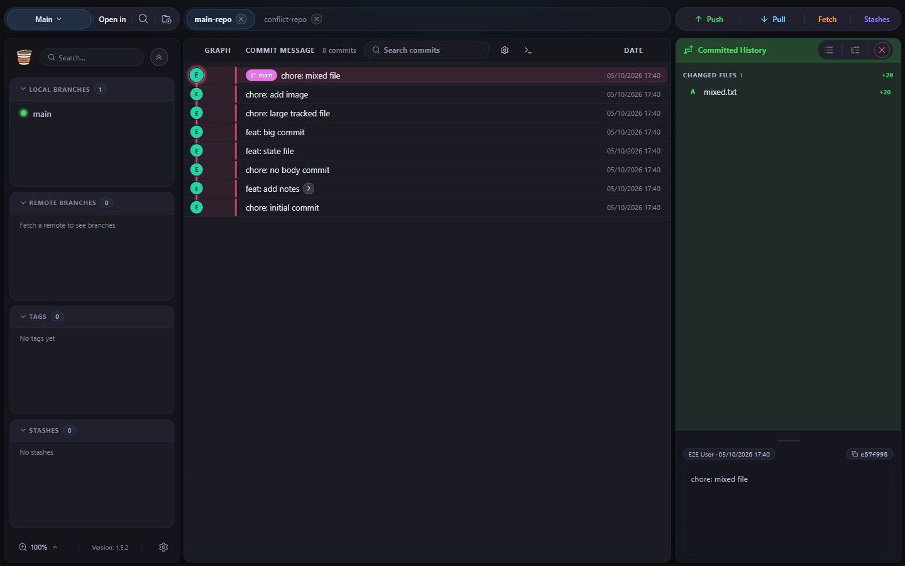
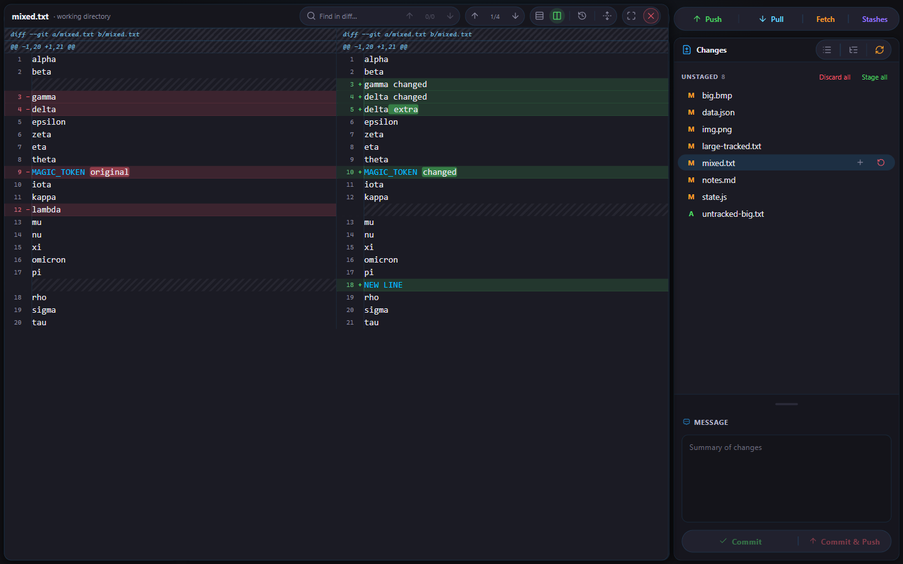
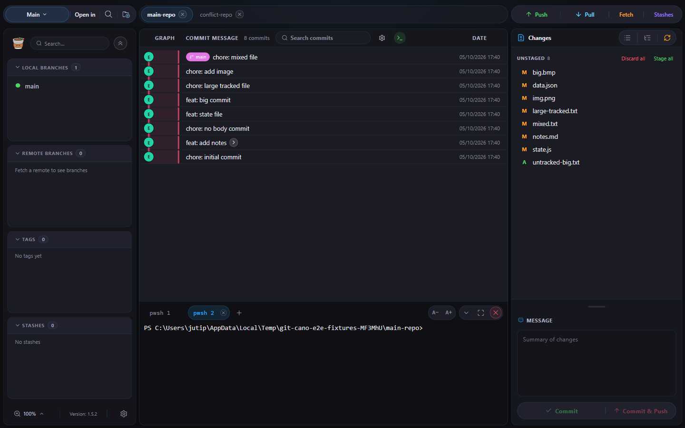
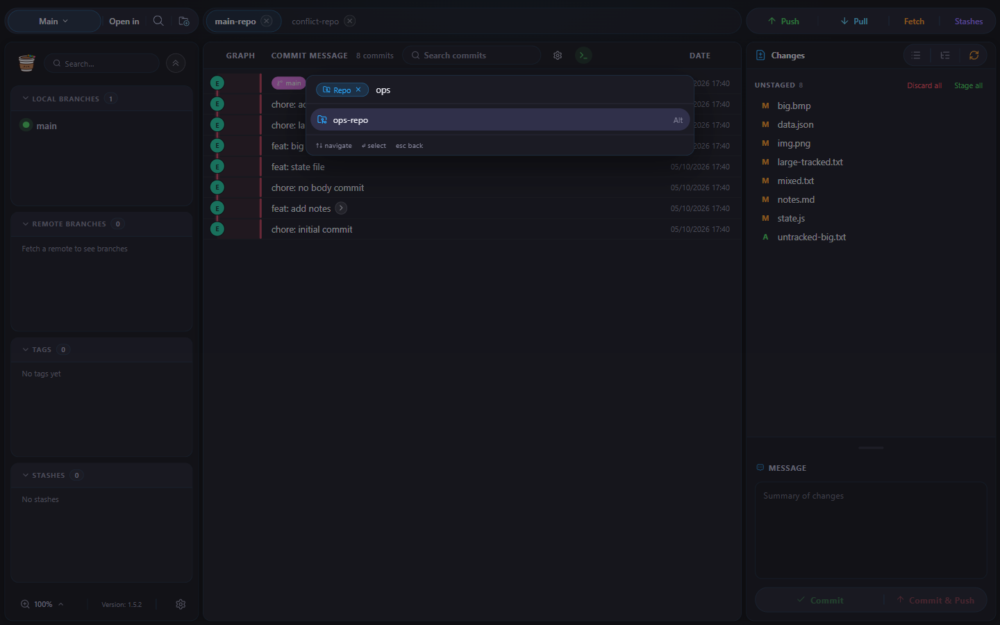
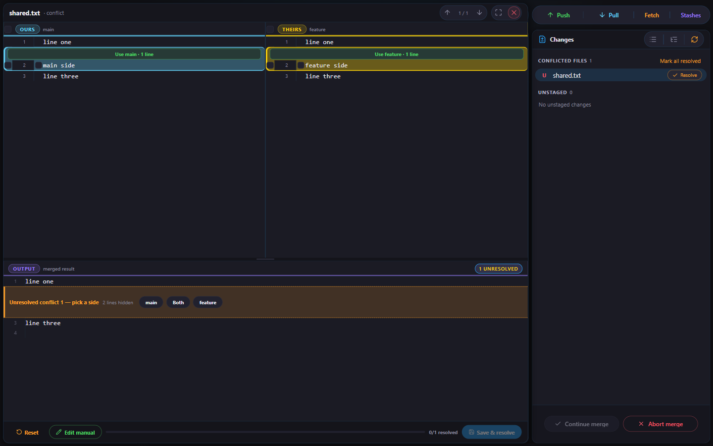
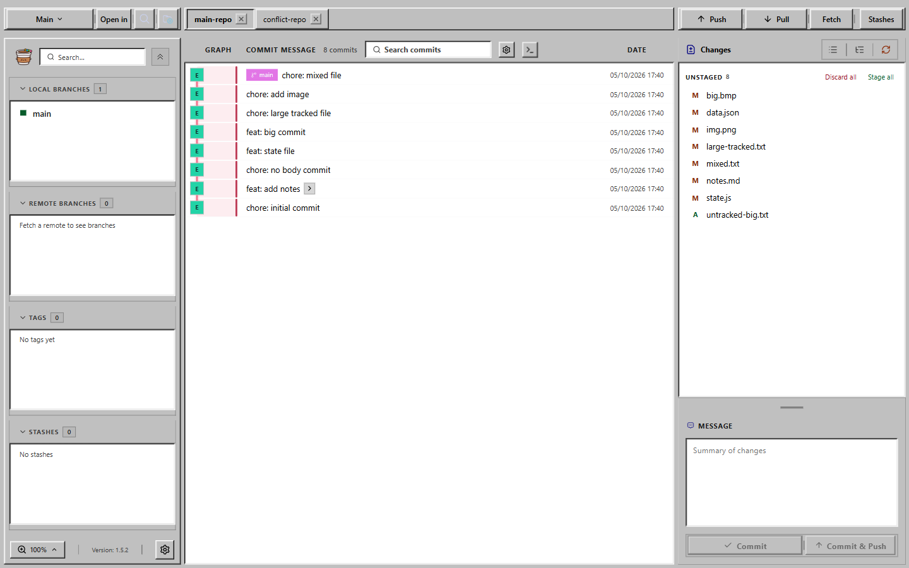

<div align="center">


# git-cano

**Everyday Git, without the clutter.**

A lightweight, open-source Git GUI for Windows and macOS — review history, stage changes, manage branches, and commit in one calm place.

[](https://github.com/Jutipong/git-cano/releases/latest)
[](LICENSE)
[](#install)
[](https://www.electronjs.org)
[](https://vuejs.org)
[](https://www.typescriptlang.org)
[](https://pnpm.io)

[Install](#install) · [Features](#features) · [Shortcuts](#shortcuts) · [Development](#development) · [Report an issue](https://github.com/Jutipong/git-cano/issues)

</div>



## Screenshots

| Commit history                                 | Side-by-side diff                          |
| ---------------------------------------------- | ------------------------------------------ |
|  |  |

| Terminal                                            | Command palette                                       |
| --------------------------------------------------- | ----------------------------------------------------- |
|  |    |

| Conflict resolver                                     | Win9x theme                                       |
| ----------------------------------------------------- | ------------------------------------------------- |
|  |  |

## Why git-cano

- **Fast by default** — local data renders first, remote tags load in the background, and the commit graph is virtualized.
- **Git stays out of the UI** — every operation runs in the main process through `simple-git`.
- **A terminal that respects Thai** — a real PTY with xterm Unicode 11 widths and UTF-8 forced on Windows.
- **AI when you want it** — optional commit messages via OpenCode Go or OpenRouter.

## Features

### Repositories & workspaces

- Open and clone repositories; keep several open as tabs.
- Workspaces group repos and remember their tabs and active repo.
- Find any repo across all workspaces from the command palette.
- Reopen the workspace's saved tabs and active repo on startup; a workspace with no session yet falls back to your most recent repo.

### History & diffs

- Interactive commit graph with branch/tag chips, author details, and search.
- Stage files or single hunks; commit and amend with a title-length counter.
- Unified or side-by-side diffs with word-level highlights, image diffs, and binary detection.
- Find in a diff, copy either side's full file, or expand one pane to full width and fullscreen.
- Blame lens, blame report, per-file history, reflog viewer, and rendered Markdown/JSON previews.
- Tree or flat file lists with a changed-files / all-files toggle, plus ignore rules from the file menu.
- Solo a branch to focus its history; files that branch never touched fade in Changes.

### Branches, tags & remotes

- Create, checkout, delete, merge, rebase, and cherry-pick from the graph.
- Interactive rebase with reorder, reword, squash, fixup, edit, and drop, plus a HEAD-range squash from the commit menu.
- Revert a commit or reset to it (soft or hard), and restore lost work from the reflog.
- Tags, remotes, fetch/pull/push, and stashes — including pushing and deleting tags on the remote.
- Switch to a local or remote branch with uncommitted changes: keep, stash, or discard them.
- Per-line conflict resolver with ours/theirs picks, manual editing, and continue/abort.
- SSH keys in Settings → Remotes: pick the active key, generate a pair, test it, and copy the public key.

### Terminal

- Built-in terminal panel with a configurable number of shell tabs per repo (4 by default).
- Shells survive repo and workspace switches; tabs can be renamed and reordered.
- Docked strip or full-height overlay (Alt+Enter), with an optional full-window width.
- Ctrl/Cmd+click a printed URL to open it in your default browser; Ctrl+Shift+C copies.
- Inline Sixel/iTerm images, mouse support for TUIs, and Thai-friendly Unicode 11 widths.
- Configurable shell, font family, and font size, independent of the interface font size.

### AI commit messages _(optional)_

- OpenCode Go or OpenRouter providers, with a model list scoped to your catalog.
- Generate only, auto commit, or auto commit and push.
- Extra rules for generated messages, `minimal` reasoning effort, and optional auto-format before generating.

### Interface

- Dark, Dark Modern, Light, Light Retro, and two Win9x themes.
- Command palette for repos, branches, workspaces, actions, settings, open-in targets, and AI.
- Mini sidebar (Ctrl+B), configurable commit-graph columns and date format, and a 12–16px UI font size.
- Customizable shortcuts per platform, plus configurable update checks, toast duration, and refresh interval.
- In-app updates on Windows; macOS downloads from the release page. A "What's new" changelog opens after each update.
- Transient toasts with a countdown, plus a timed Undo for risky actions.

## Install

Download the latest build from **[GitHub Releases](https://github.com/Jutipong/git-cano/releases/latest)**.

**Windows**

Run `git-cano-<version>-setup.exe` and follow the installer. In-app updates are supported. The build is unsigned, so SmartScreen may warn — choose **More info → Run anyway**.

**macOS (Apple Silicon)**

The `.dmg` is unsigned and updated manually. Open it, drag **Git Cano** into Applications, then clear the quarantine flag once:

```bash
xattr -cr /Applications/Git\ Cano.app
```

Right-click **Git Cano → Open** the first time you launch it.

## Development

Requires [Node.js](https://nodejs.org), [pnpm](https://pnpm.io) 12+, and Git on `PATH`. Build scripts for
Electron, esbuild, and node-pty are pre-approved in `pnpm-workspace.yaml`, so install runs without a prompt.

```bash
pnpm install
pnpm dev
```

| Command          | Description                                   |
| ---------------- | --------------------------------------------- |
| `pnpm dev`       | Dev mode with hot reload                      |
| `pnpm build`     | Production build                              |
| `pnpm lint`      | oxlint, TypeScript check, and the style guard |
| `pnpm typecheck` | TypeScript check for both projects            |
| `pnpm test:unit` | Unit tests                                    |
| `pnpm test:e2e`  | Build and run Playwright tests                |
| `pnpm test`      | Release gate (lint + typecheck + unit + e2e)  |
| `pnpm format`    | Format with oxfmt                             |
| `pnpm dist:win`  | Windows installer → `release/`                |
| `pnpm dist:mac`  | macOS `.dmg` → `release/`                     |

```text
src/
├── main/       # Electron main process and all Git operations
├── preload/    # Secure window.api bridge
├── shared/     # Shared types, model catalog, and lane helpers
└── renderer/   # Vue 3 app: components, Pinia stores, styles
```

Git never runs in the renderer: every call flows `component → window.api → main process → simple-git`.

## Shortcuts

<details>
<summary><b>Show the cheat sheet</b></summary>

| Action                        | macOS                | Windows              |
| ----------------------------- | -------------------- | -------------------- |
| Fetch                         | `Ctrl+Shift+↓`       | `Ctrl+Shift+↓`       |
| Pull / Push                   | `Ctrl+↓` / `Ctrl+↑`  | `Ctrl+↓` / `Ctrl+↑`  |
| Open / clone repo             | `Ctrl+O` / `Ctrl+N`  | `Ctrl+O` / `Ctrl+N`  |
| Close tab / terminal          | `Ctrl+W`             | `Ctrl+W`             |
| Toggle terminal               | `` Ctrl+` ``         | `` Ctrl+` ``         |
| New terminal tab              | `Ctrl+T`             | `Ctrl+T`             |
| Next terminal tab             | `Ctrl+Tab`           | `Ctrl+Tab`           |
| Previous terminal tab         | `Ctrl+Shift+Tab`     | `Ctrl+Shift+Tab`     |
| Terminal full height          | `Alt+Enter`          | `Alt+Enter`          |
| Close terminal panel          | —                    | `Alt+F4`             |
| Mini sidebar                  | `Ctrl+B`             | `Ctrl+B`             |
| Search commits / find in diff | `⌘F`                 | `Ctrl+F`             |
| Command palette               | `Ctrl+P` / `Shift×2` | `Ctrl+P` / `Shift×2` |
| Commit                        | `⌘↵`                 | `Ctrl+↵`             |
| Settings                      | `Ctrl+,`             | `Ctrl+,`             |
| Zoom in / out                 | `⌘=` / `⌘-`          | `Ctrl+=` / `Ctrl+-`  |
| Reset zoom                    | `⌘0`                 | `Ctrl+0`             |
| Show shortcuts                | `?`                  | `?`                  |

Shortcuts for fetch, pull, push, open, clone, search, settings, the palette, and the terminal toggle
can be rebound per platform in **Settings → Shortcuts**. Terminal tab cycling, full height, and
closing the panel only apply while the terminal panel has focus.

</details>

## Good to know

- Remote tag status needs an `origin` remote and a network connection; it loads in the background on purpose.
- Cherry-pick and branch merge refuse to run on a dirty worktree and ask you to commit or stash first.
- Push, pull, fetch, and clone ignore `GIT_CONFIG_*` and `GIT_SSH_COMMAND` exported by other tools and inject their own credentials.
- A branch and a tag may share a name; the sidebar keeps each ref unambiguous.

## License

[MIT](LICENSE) © git-cano contributors

Building with AI? Read [AGENTS.md](AGENTS.md) first.
